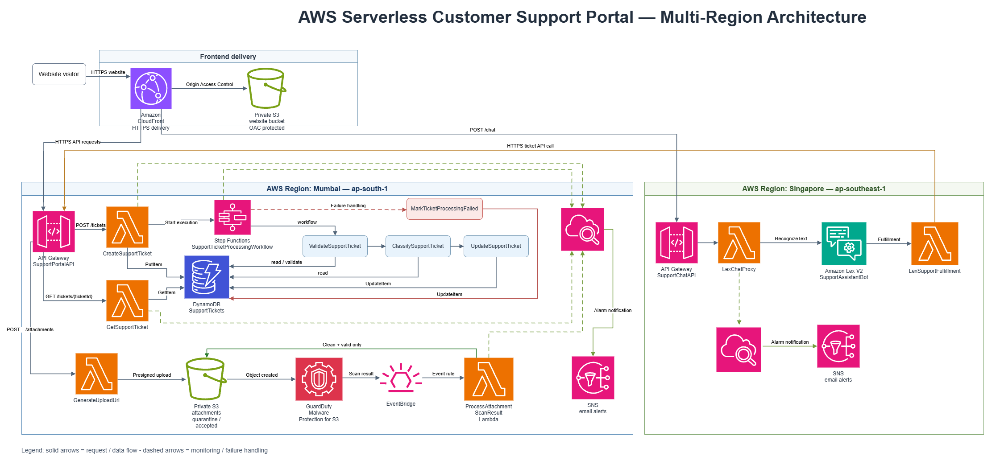

# Architecture Overview

The project uses a serverless architecture across two AWS regions: **Mumbai (`ap-south-1`)** for the main support platform and **Singapore (`ap-southeast-1`)** for the chatbot.

- **Frontend:** Amazon CloudFront delivers the website over HTTPS from a private S3 bucket using Origin Access Control (OAC).
- **Ticket management:** API Gateway connects the frontend to Lambda functions that create tickets, retrieve ticket details, and generate secure attachment upload URLs. Ticket data is stored in DynamoDB.
- **Ticket processing:** AWS Step Functions coordinates ticket validation, classification, and updates, with a separate failure-handling step.
- **Attachment security:** Uploaded files are stored in a private S3 bucket under `quarantine/`. GuardDuty scans the files, and EventBridge triggers a Lambda function to move only clean and valid attachments to `accepted/`.
- **Chatbot:** Amazon Lex V2 handles conversations through a separate API Gateway and Lambda function in Singapore. The fulfillment Lambda communicates with the main Mumbai API for ticket-related operations.
- **Monitoring and alerts:** CloudWatch collects logs and monitors errors and failed workflow executions. SNS sends email alerts for configured alarms.

This design separates the frontend, backend, chatbot, and attachment-processing components while using managed AWS services to reduce infrastructure management.