# AWS Serverless Customer Support Platform — Screenshots

This document provides visual evidence of the implementation, functionality, security controls, and monitoring configuration of the AWS Serverless Customer Support Platform.

The screenshots are organized into four categories: application functionality, AWS architecture and processing, attachment security, and monitoring and cost controls.

> **Note:** These screenshots demonstrate the configuration and behavior captured at the time of testing. A configured resource does not necessarily mean its complete end-to-end workflow has been tested.

## Table of Contents

- [1. Application](#1-application)
- [2. AWS Architecture and Processing](#2-aws-architecture-and-processing)
- [3. Attachment Security](#3-attachment-security)
- [4. Monitoring and Cost Controls](#4-monitoring-and-cost-controls)

---

## 1. Application

These screenshots demonstrate the user-facing support portal, ticket management, chatbot interactions, and attachment upload functionality.

### 1.1 CloudFront Website

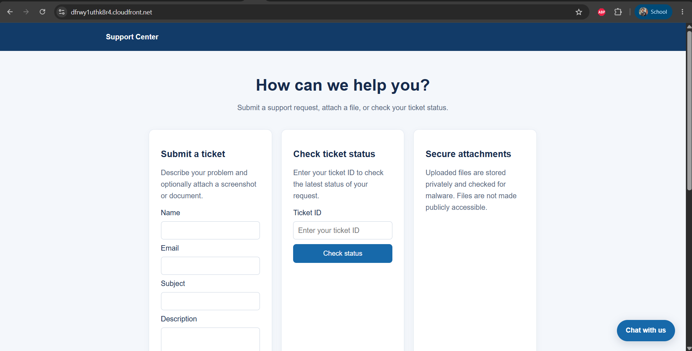

The support portal is delivered through Amazon CloudFront over HTTPS, with the static frontend hosted in a private Amazon S3 bucket.

### 1.2 Ticket Creation

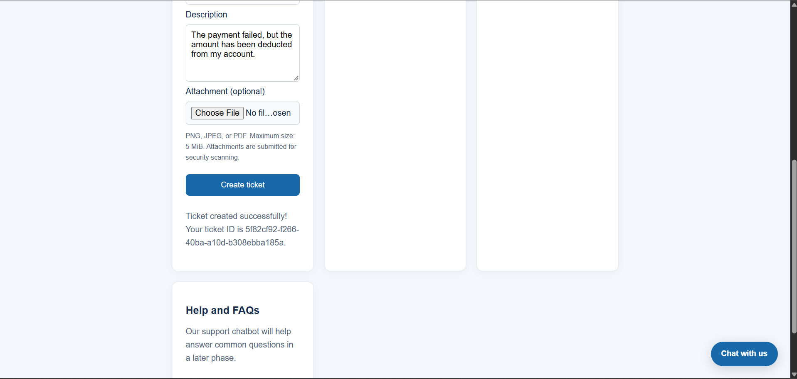

Shows a successful support ticket submission and the ticket ID returned to the user.

### 1.3 Ticket Status Lookup

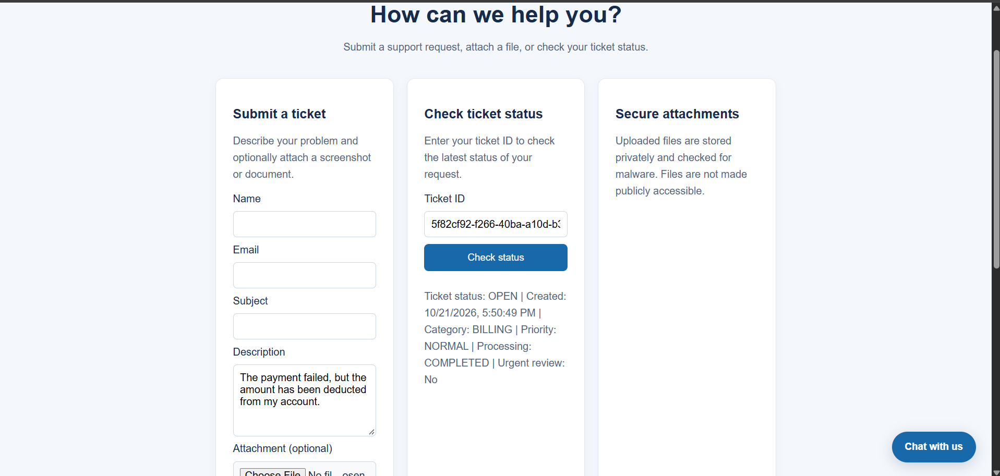

Demonstrates retrieving support ticket information using a ticket ID through the website.

### 1.4 Chatbot Greeting

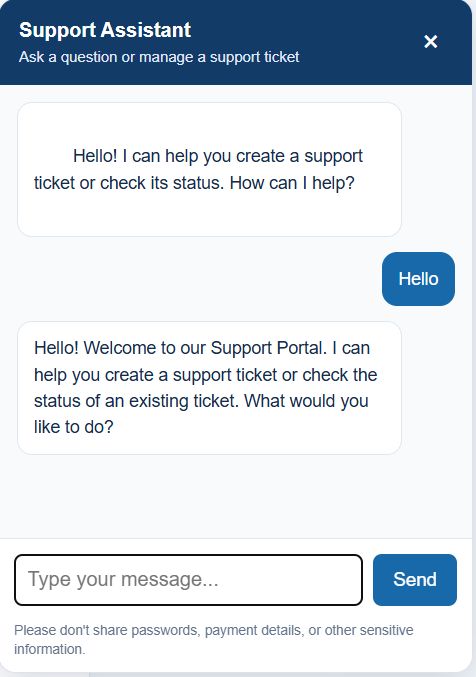

Shows the chatbot responding to a greeting through the website's chat interface.

### 1.5 Chatbot Ticket Workflow

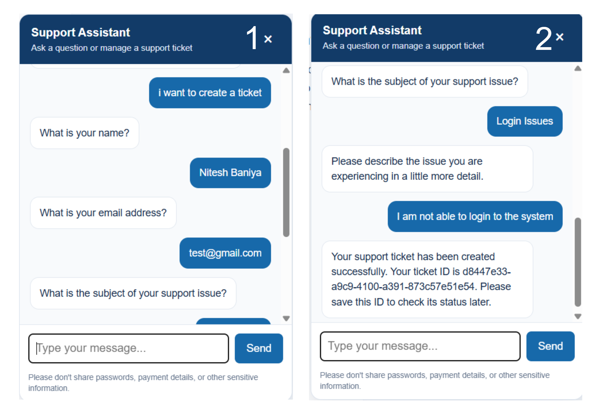

Illustrates the chatbot's ticket-creation conversation, including the collection of relevant information.

### 1.6 Chatbot Status Lookup

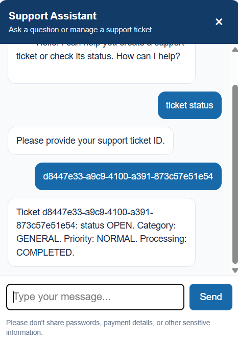

Demonstrates the chatbot's response to a ticket-status request.

### 1.7 Attachment Upload

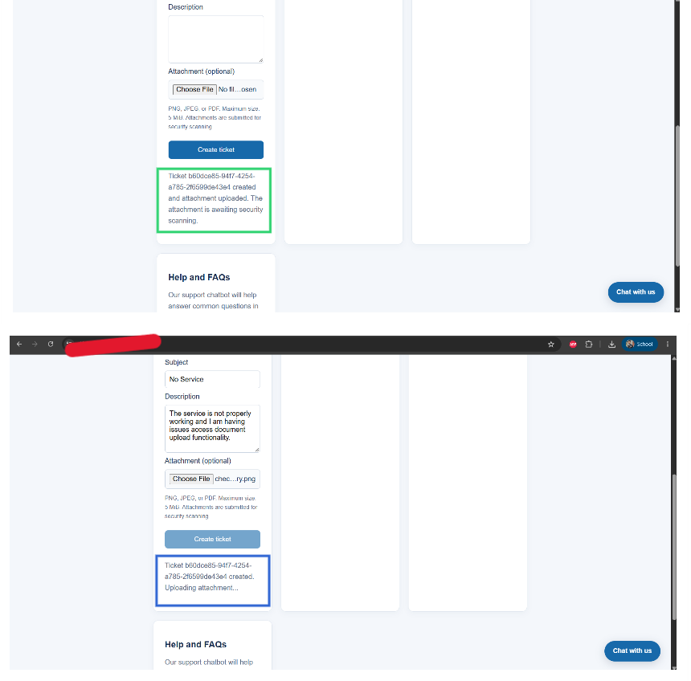

Shows the frontend initiating an attachment upload through the backend-generated presigned upload request.

---

## 2. AWS Architecture and Processing

These screenshots document the AWS resources responsible for frontend delivery, API routing, ticket storage, workflow orchestration, and chatbot configuration.

### 2.1 CloudFront Origin Configuration

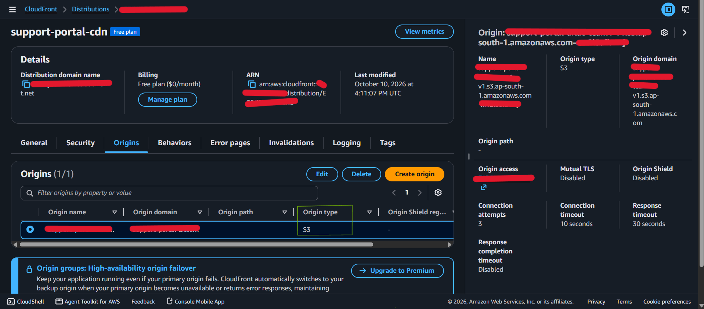

Shows the CloudFront origin configuration and Origin Access Control (OAC), which allows CloudFront to access the private S3 website bucket.

### 2.2 API Gateway Routes

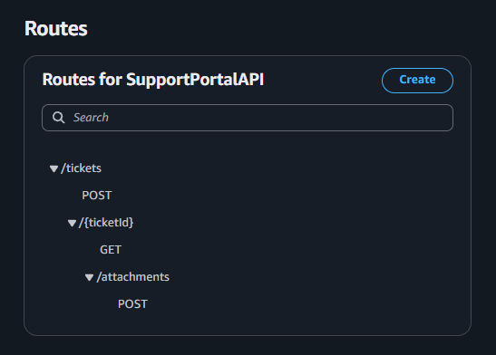

Displays the configured API routes used for support ticket creation, ticket retrieval, and attachment upload authorization.

### 2.3 DynamoDB Ticket Record

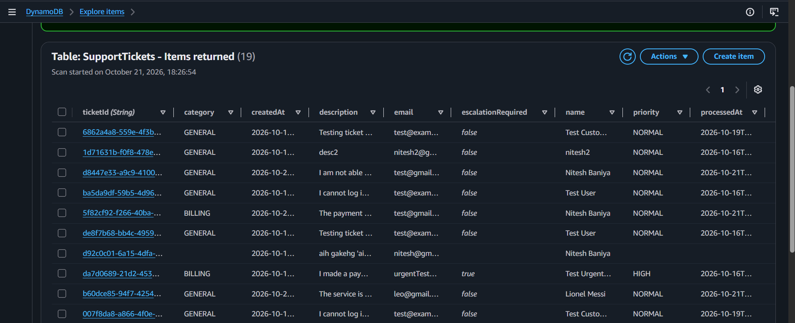

Shows an example synthetic support ticket stored in the `SupportTickets` DynamoDB table.

### 2.4 Step Functions Successful Execution

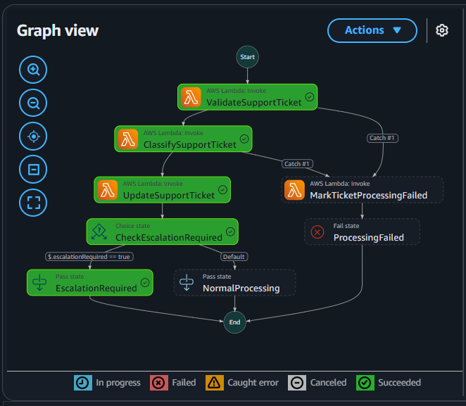

Demonstrates a successful execution of the ticket-processing workflow, including its configured validation, classification, and update steps.

### 2.5 Step Functions Failure Handling

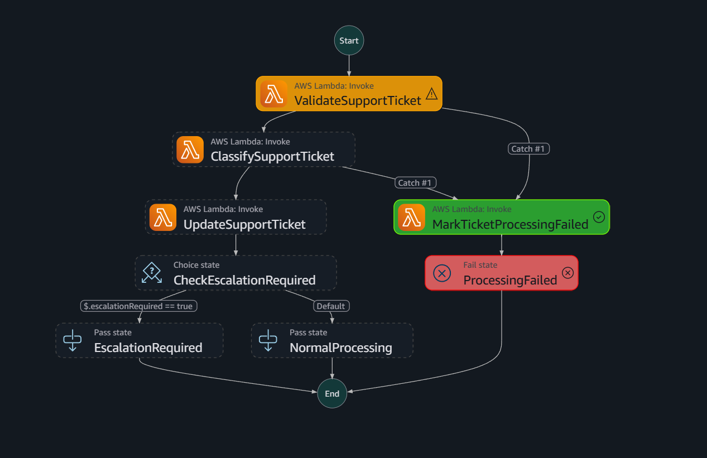

Illustrates the workflow's failure-handling path, if a corresponding failure scenario has been executed and verified.

### 2.6 Amazon Lex Configuration

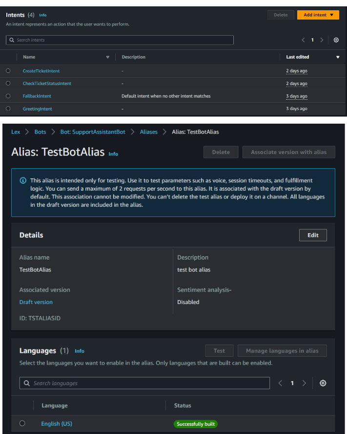

Shows the Amazon Lex V2 chatbot configuration, including its configured intents and test alias.

---

## 3. Attachment Security

These screenshots document the private attachment-storage configuration and the event-driven malware-scanning integration.

### 3.1 Private Attachment Bucket

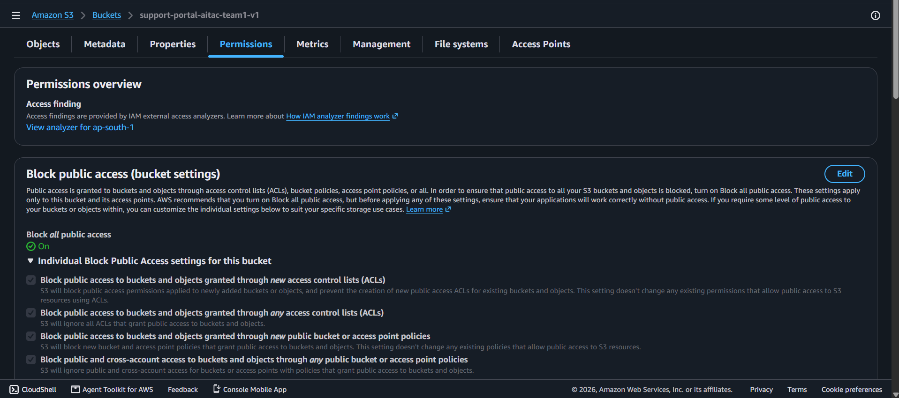

Shows the Amazon S3 attachment bucket's Block Public Access settings, helping prevent unintended public access to uploaded files.

### 3.2 GuardDuty Malware Protection Configuration

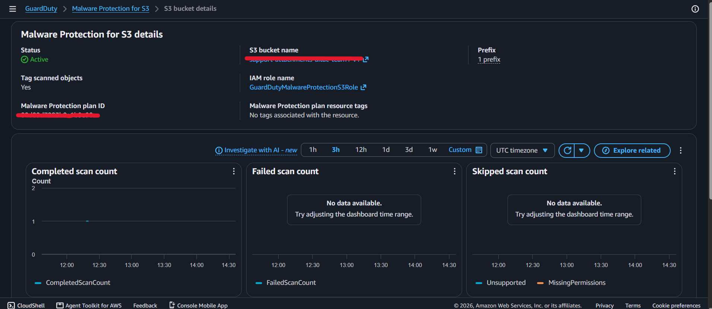

Displays the GuardDuty Malware Protection for S3 configuration and the `quarantine/` prefix used for attachment scanning.

### 3.3 EventBridge Scan-Result Rule

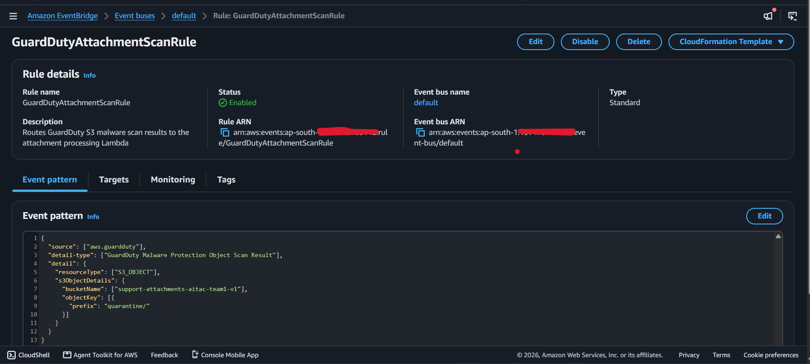

Shows the EventBridge rule configured to route relevant malware-scan result events to the `ProcessAttachmentScanResult` Lambda function.

---

## 4. Monitoring and Cost Controls

These screenshots document the monitoring resources and cost-awareness measures configured for the application.

### 4.1 CloudWatch Alarms

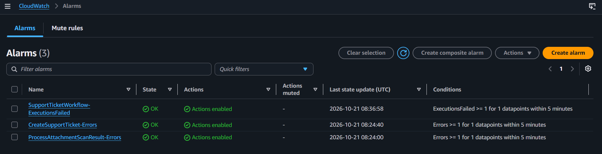

Shows the configured CloudWatch alarms for selected Lambda functions and the Step Functions workflow. 

### 4.2 CloudWatch Logs

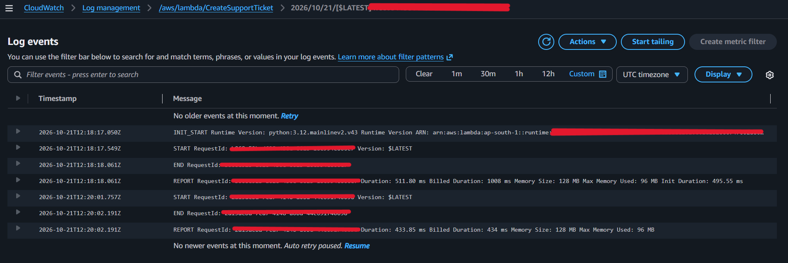

Shows relevant AWS Lambda execution logs and troubleshooting information for monitoring application behavior and diagnosing errors.

### 4.3 SNS Email Subscription

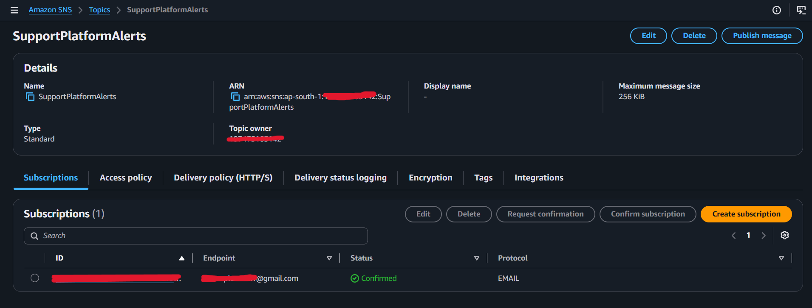

Shows the confirmed Amazon SNS email subscription used to receive monitoring alerts and notifications.

### 4.4 AWS Budget

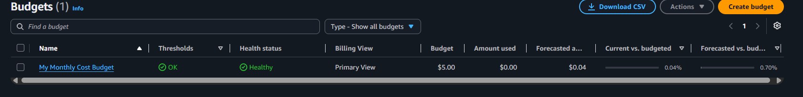

Shows the configured AWS Budgets thresholds and cost notifications used to monitor project spending and help control costs.

---

## Screenshot and Security Notes

- Synthetic ticket records and dummy contact information have been used throughout the project.
- Credentials and other information that I decided to keep private have been redacted from the screenshots.
- CloudWatch Logs screenshots have been reviewed to avoid exposing sensitive application data or secrets.
- The Amazon SNS email subscription has been confirmed before being documented as active.
- AWS Budgets thresholds and notification settings have been configured to monitor project spending.
- Screenshots have been included to document the implemented AWS resources and application functionality.
- End-to-end workflows have been documented where corresponding testing and verification have been completed.
- All screenshots are stored in the `screenshots/` directory, with filenames matching the relative paths used in this document.

These screenshots complement the main [project README](../README.md), which explains the architecture, application workflows, security controls, limitations, and future improvements.
